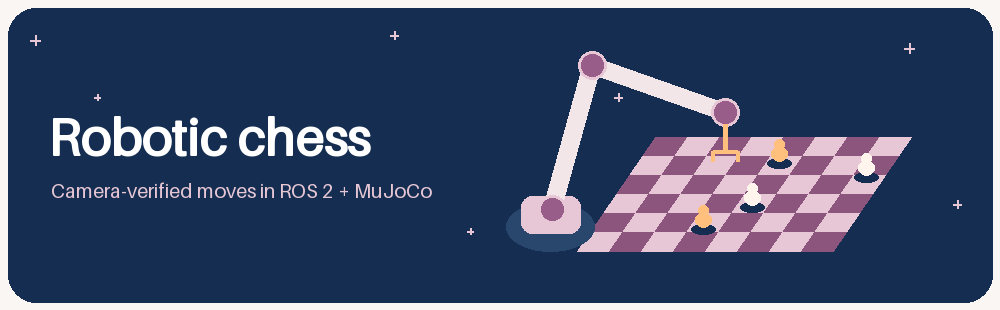
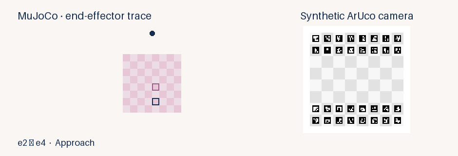
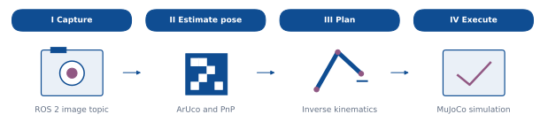
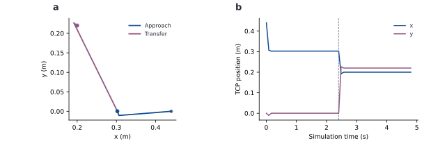

# Vision-guided robotics with ROS 2



A robot can reach the right coordinates and still leave a piece on the wrong square. This simulated workcell reads ArUco tags, moves a chess piece with MuJoCo and checks the board through a second camera observation before updating the game.



The replay shows the sampled MuJoCo trajectory for the opening move **e2 → e4**, paired with the actual synthetic camera frames before motion and after verification. [Explore the interactive match replay](https://martaforjaz.github.io/#robotics).

To regenerate both visuals, run `python -m pip install -r requirements.txt Pillow==12.2.0`, then `python readme_visuals.py`.

## Pick-and-place benchmark

A simulated manipulation demo that detects an ArUco marker, estimates its camera pose, solves planar inverse kinematics and executes the resulting targets in MuJoCo. ROS 2 carries the synthetic camera image and publishes the simulation result.


The vector figures are available as PDF in [figures/](figures/). With Python, NumPy and Matplotlib installed, run `python paper_figures.py` to regenerate them. The visual conventions follow [figures4papers](https://github.com/ChenLiu-1996/figures4papers).

## Results

The reachable marker produced a target about **0.303 m** from the arm base. MuJoCo brought the end effector to the pick location and transferred the payload to **(0.20, 0.22) m**, within the demo's **2 mm** tolerance at both stages. A marker at about **0.610 m** was rejected as unreachable. A blank image produced no motion plan.



Panel a shows the end-effector path. Panel b shows position over simulation time. The dashed line marks the transition from approach to transfer.

[Scenario results](evidence/scenarios.json) · [Sampled simulator trajectory](evidence/trajectory.csv)

## Vision-verified chess

The table-top workcell reads individually tagged pieces from a synthetic overhead image. It checks each legal move, runs one transfer in MuJoCo or two transfers for a capture, maps the simulated payload endpoint to a board square, and reacquires the camera frame before committing the resulting FEN.

The scripted run completed **10 plies**, including **two captures** and **one recovered camera occlusion**. A separate injected wrong-square placement was rejected without updating the game. The Stockfish run completed another ten plies. [Scripted trace](evidence/chess-scripted.json) · [Stockfish trace](evidence/chess-stockfish.json) · [Interactive replay](https://martaforjaz.github.io/#robotics)

```bash
python chess_demo.py
python chess_demo.py --stockfish /path/to/stockfish
```

After building the ROS package, run `ros2 run vision_grasp chess_demo`. Publish a UCI move such as `e2e4` to `/chess/move` as a `std_msgs/msg/String`, then inspect `/chess/result`. Pass `--ros-args -p stockfish_path:=/path/to/stockfish` to request an engine reply after each accepted move.

The board uses fixed synthetic calibration and ArUco identifiers. Each transfer uses an idealized grasp, with no collision-aware planning. Castling and promotion are explicitly unavailable in this demo.

## Run the simulation

```bash
python -m pip install -r requirements.txt
python check_demo.py
python figures.py
```

For ROS 2 Jazzy on Ubuntu 24.04, install ROS 2 and colcon, then clone the repository into the `src/` directory of a ROS workspace. Make the Python requirements available to the same Python interpreter that loads ROS 2. From the workspace root:

```bash
source /opt/ros/jazzy/setup.bash
colcon build --packages-select vision_grasp
source install/setup.bash
ros2 run vision_grasp demo --ros-args -p scene:=reachable
```

In another sourced terminal, run `ros2 topic echo /simulated_grasp/plan --once`. Change `scene` to `unreachable` or `missing` to exercise the refusal paths.

## Scope

The offline runner verifies OpenCV, inverse kinematics and MuJoCo without requiring ROS to be installed. This reconstruction uses a synthetic camera with known intrinsics, a planar two-link arm, and an idealized grasp: the payload follows the end effector after arrival. It does not model contact or collision avoidance and sends no commands to real hardware.

The staged design is inspired by [MoveIt's public pick-and-place tutorial](https://moveit.picknik.ai/main/doc/tutorials/pick_and_place_with_moveit_task_constructor/pick_and_place_with_moveit_task_constructor.html). The implementation uses its own lightweight planner and simulation and is separate from the earlier university project.
