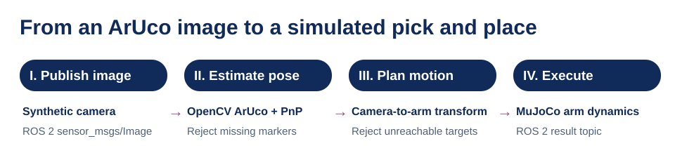
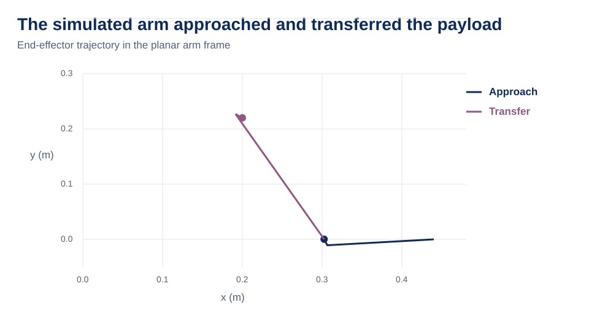

# Vision Guided Pick and Place with ROS 2

A simulated manipulation demo that detects an ArUco marker, estimates its camera pose, solves planar inverse kinematics and executes the resulting targets in MuJoCo. ROS 2 carries the synthetic camera image and publishes the simulation result.



## Results

The reachable marker produced a target about **0.303 m** from the arm base. MuJoCo brought the end effector to the pick location and transferred the payload to **(0.20, 0.22) m**, within the demo's **2 mm** tolerance at both stages. A marker at about **0.610 m** was rejected as unreachable. A blank image produced no motion plan.



[Scenario results](evidence/scenarios.json) · [Sampled simulator trajectory](evidence/trajectory.csv)

## Run the simulation

```bash
python -m pip install -r requirements.txt
python check_demo.py
python figures.py
```

For ROS 2 Jazzy on Ubuntu 24.04, install ROS 2 and colcon, then clone the repository into the `src/` directory of a ROS workspace. Make the Python requirements available to the same Python interpreter that loads ROS 2. From the workspace root:

```bash
source /opt/ros/jazzy/setup.bash
colcon build --packages-select vision_grasp
source install/setup.bash
ros2 run vision_grasp demo --ros-args -p scene:=reachable
```

In another sourced terminal, run `ros2 topic echo /simulated_grasp/plan --once`. Change `scene` to `unreachable` or `missing` to exercise the refusal paths.

## Scope

The offline runner verifies OpenCV, inverse kinematics and MuJoCo without requiring ROS to be installed. This reconstruction uses a synthetic camera with known intrinsics, a planar two-link arm, and an idealized grasp: the payload follows the end effector after arrival. It does not model contact or collision avoidance and sends no commands to real hardware.

The staged design is inspired by [MoveIt's public pick-and-place tutorial](https://moveit.picknik.ai/main/doc/tutorials/pick_and_place_with_moveit_task_constructor/pick_and_place_with_moveit_task_constructor.html). The implementation uses its own lightweight planner and simulation and is separate from the earlier university project.
